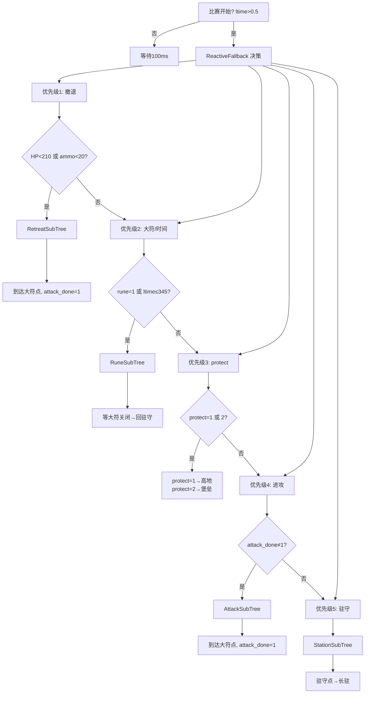

# 哨兵行为树 v2 逻辑框图

## 主树流程

```
┌─────────────────────────────────────────────────────────────────┐
│ Parallel (success=2, fail=1)                                    │
│  ├── Update 节点 (持续刷新黑板)                                  │
│  └── Repeat(-1) → Fallback                                     │
│       ├── Sequence "Game_Active"                                │
│       │    ├── Inverter → CheckTime(ltime>0.5)  [比赛开始判断]   │
│       │    └── ReactiveFallback "Main_Decision"                 │
│       │         ├─P1: 撤退 (HP<210 或 ammo告警)                  │
│       │         ├─P2: 大符/时间 (rune=1 或 ltime≤345)            │
│       │         ├─P3: protect (protect=1→高地, =2→堡垒)          │
│       │         ├─P4: 进攻 (attack_done≠1, 一次性)               │
│       │         └─P5: 驻守 (默认)                                │
│       └── Sleep 100ms (等待比赛开始)                              │
└─────────────────────────────────────────────────────────────────┘
```

## 优先级决策逻辑



## 子树详细流程

### AttackSubTree (进攻)
```
SetArrive(0) → BuildPoseArray(中继1→中继2→大符) 
→ NavigateThroughPoses → SetArrive(1) 
→ current_stage="holding_rune_point" → attack_done=1
```

### RuneSubTree (大符)
```
SetArrive(0) → NavigateToPose(大符) → SetArrive(1)
→ ReactiveFallback: CheckSignal(rune=0) || Sleep(30s)
→ SetArrive(0) → NavigateToPose(驻守点) → SetArrive(1)
→ current_stage="holding_station"
```

### StationSubTree (驻守)
```
SetArrive(0) → NavigateToPose(驻守点) → SetArrive(1)
→ current_stage="holding_station" → Sleep(24h)
```

### RetreatSubTree (撤退)
```
WaitForRevive(HP=0时等待复活)
→ 第一段: SetArrive(0) → BuildPoseArray(中继3→中继4→补给点)
→ NavigateThroughPoses → SetArrive(1)
→ Wait(4.0s) [撤离点等待4秒]
→ 第二段: SetArrive(0) → BuildPoseArray(补给点→中继4→中继3→大符)
→ NavigateThroughPoses → SetArrive(1)
→ current_stage="holding_rune" → attack_done=1
```

### Protect_Mission (protect指令)
```
protect=1: SetArrive(0) → NavigateToPose(高地点) → SetArrive(1)
protect=2: SetArrive(0) → NavigateToPose(堡垒点) → SetArrive(1)
```

## 串口数据映射

| 串口 RX | ROS Topic | 黑板变量 | 行为树使用 |
|---------|-----------|---------|-----------|
| game_time | /referee/game_time | ltime | CheckTime(比赛开始/大符触发) |
| hp | /referee/hp | hp | CheckHP(撤退)、WaitForRevive |
| rune | /referee/rune | rune | CheckSignal(大符/回驻守) |
| protect | /referee/protect | protect | CheckSignal(高地/堡垒) |
| ammo | /referee/ammo | ammo | CheckAmmo(撤退) |

## arrive 状态说明

| 任务 | arrive=0 (移动中) | arrive=1 (已到达) |
|------|------------------|-------------------|
| 进攻 | BuildPoseArray前 | 到达大符点后 |
| 大符 | NavigateToPose前 | 到达大符点后/返回驻守后 |
| 驻守 | NavigateToPose前 | 到达驻守点后 |
| 撤退 | 第一段BuildPoseArray前 | 到达补给点后/到达大符点后 |
| protect | 触发protect后 | 到达高地/堡垒后 |
